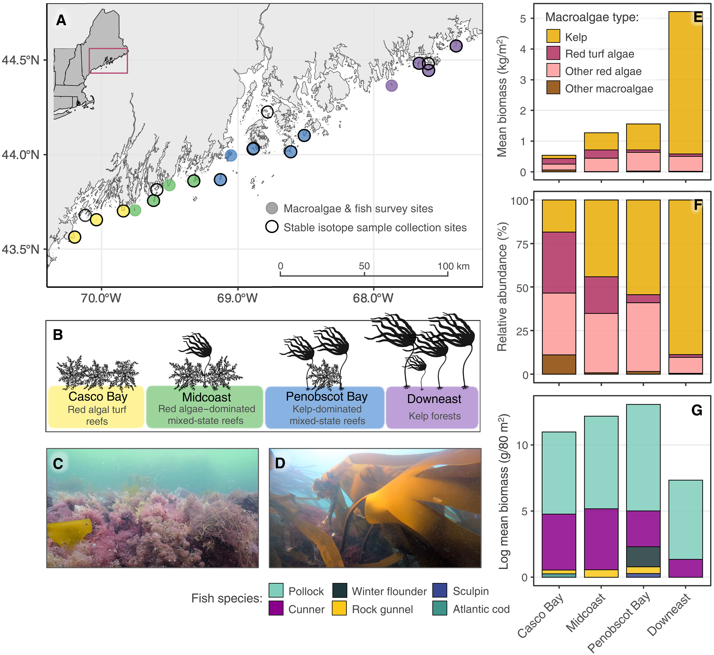

# Introduction

Kelp forests are important marine habitats that support biodiversity, provide food and shelter for numerous species, and contribute to coastal ecosystem functioning. However, warming ocean temperatures and other environmental pressures are driving changes in kelp forest communities, including shifts towards turf-dominated habitats.

This report examines macroalgal biomass patterns across four coastal regions of Maine, USA, using publicly available data from Yiu et al. (2025b). The original study investigated how kelp forest loss and the expansion of turf algae influence energy pathways within temperate marine food webs.

The objective of this exercise is to critically evaluate the visualisation of macroalgal biomass in the published study and reconstruct an alternative figure using R and ggplot2. Particular attention is given to communicating differences in macroalgal composition across regions and improving the clarity and interpretability of the original visualisation.

# Original Scientific Figure

Figure 1 from Yiu et al. (2025b) illustrates regional differences in macroalgal biomass and community composition across coastal Maine. This exercise focuses on panels E and F, which compare total biomass and the relative contributions of different macroalgal groups.

{width="90%"}

# Visual Critique

## Intended Ecological Message

The original figure from Yiu et al. (2025b) illustrates spatial differences in macroalgal community composition across four coastal regions of Maine. Panels E and F demonstrate how total macroalgal biomass and the relative contributions of different algal groups vary geographically, highlighting differences between turf-dominated and kelp-dominated habitats.

The use of stacked bars and consistent colour coding allows readers to identify broad differences in macroalgal communities. In particular, the figure effectively communicates the substantially greater contribution of kelp to total macroalgal biomass in Downeast compared with Casco Bay.

### Limitations of the Original Visualisation

**1. Limited Representation of Variability**

Panel E presents mean macroalgal biomass using stacked bars without displaying variability among sampling locations. Although the figure effectively summarises regional patterns, it does not communicate the distribution of observations or the uncertainty associated with the reported means.

This limits the reader's ability to evaluate whether regional differences reflect relatively consistent patterns across sampling units or are influenced by particularly high or low biomass measurements.

**2. Difficulty Comparing Algal Groups**

Panel F uses stacked percentage bars to illustrate differences in macroalgal community composition. While this is useful for showing relative proportions, the absence of a common baseline for most categories makes direct comparisons between individual algal groups across regions more difficult.

Additionally, proportional biomass can obscure differences in absolute biomass. Two regions may have similar relative contributions from a particular algal group despite substantial differences in the total amount of biomass present.

**3. Limited Detail on Individual Sampling Units**

Both panels emphasise regional summaries rather than individual observations. Consequently, the figures provide limited information about variation among sampling quadrats within each coastal region.

Displaying these observations could provide additional ecological context, particularly where macroalgal biomass is highly variable across sampling locations.

### Improvements Through Reconstruction

To address these limitations, two alternative visualizations were developed using the publicly available macroalgal biomass dataset.

The first reconstruction separates the five macroalgal groups into individual panels, allowing regional differences in biomass to be examined independently. Individual quadrat observations are displayed alongside regional arithmetic means, providing information about the distribution and variability of biomass measurements.

The second visualization focuses specifically on kelp and red turf algae. By presenting these groups in adjacent panels with a shared biomass scale, the figure highlights differences in their regional distributions. Contrasting colours, consistent with those used in the original publication, improve visual distinction while maintaining a connection to the published figure.

A logarithmic-style transformation (`log1p`) was applied to accommodate the large differences in biomass magnitude while retaining observations with zero biomass. This improves the visibility of lower biomass values, although it also makes proportional differences less immediately intuitive than on an untransformed scale.

### Trade-offs and Considerations

Although the reconstructed figures improve the visibility of individual observations and regional biomass distributions, they do not necessarily replace the original visualization.

The original stacked bars remain more effective for communicating the overall composition of macroalgal communities, particularly the relative contributions of different algal groups to total biomass.

Furthermore, the reconstructed figures are primarily descriptive. Individual quadrats are nested within sampling sites, meaning that variability among quadrats should not automatically be interpreted as independent evidence of regional differences.

Together, the original and reconstructed visualizations provide complementary perspectives on macroalgal community structure, illustrating how different graphical approaches can emphasise different aspects of the same ecological dataset.

# Data Preparation and Wrangling

The macroalgal biomass dataset published by Yiu et al. (2025a) was obtained from the Dryad data repository and imported into R for processing and visualization. The dataset contained 1,432 records representing individual macroalgal taxa sampled across four coastal regions of Maine: Casco Bay, Midcoast, Penobscot Bay, and Downeast.

### Identifying Sampling Units

The dataset contained 118 unique sampling units, identified using combinations of sampling site, survey date, and position along the sampling transect (`meter_mark`). Each sampling unit represented a 1 m² quadrat, within which macroalgal biomass was recorded for different taxa.

Because multiple taxa could occur within the same quadrat, individual taxonomic records were not treated as independent sampling units. Instead, biomass measurements were aggregated by quadrat and macroalgal group to avoid artificially inflating the number of observations.

### Aggregating Macroalgal Biomass

Individual taxa were classified into five macroalgal groups: kelp, red turf algae, other red algae, other brown algae, and green algae.

Biomass measurements were summed within each quadrat and algal group to obtain total biomass in g/m². This produced 489 quadrat-level group records before accounting for algal groups that were not recorded in every quadrat.

### Handling Missing Values and Absent Groups

An inspection of the original dataset identified one missing biomass measurement (`NA`). This observation was retained as missing rather than automatically converted to zero, since an unrecorded measurement does not necessarily indicate the absence of biomass.

For the purposes of reconstructing regional biomass patterns, algal groups without records in a particular quadrat were assumed to be absent and assigned zero biomass. This assumption was based on the dataset's taxon-level recording structure and should be recognised as a limitation because the documentation did not explicitly confirm how absent groups were represented.

After completing the combinations of sampling units and macroalgal groups, the processed dataset contained 590 records, corresponding to 118 quadrats and five algal groups.

### Regional Biomass Summaries

Regional mean biomass, standard deviation, and standard error were calculated separately for each macroalgal group. Missing biomass measurements were excluded from these calculations, while zero-biomass observations were retained.

These summaries were used alongside individual quadrat observations to visualise regional differences in macroalgal biomass. The resulting figures are descriptive and do not account for the hierarchical structure of quadrats nested within sampling sites.

```{r setup}
# Load packages required for data analysis and visualisation
library(tidyverse)
library(here)

# Import the original macroalgal biomass dataset
kelp_data <- read_csv(
  here("data", "workshop3", "Data1_macroalgae_biomass.csv"),
  show_col_types = FALSE
)

# Inspect the dataset
glimpse(kelp_data)
```

```{r quadrat-biomass}
# Aggregate biomass by sampling unit and algal group
quadrat_biomass <- kelp_data |>
  group_by(region, site, survey_date, meter_mark, group) |>
  summarise(
    biomass_g_m2 = if (any(is.na(mass_g))) {
      NA_real_
    } else {
      sum(mass_g)
    },
    .groups = "drop"
  )

# Inspect the corrected dataset
glimpse(quadrat_biomass)
```

```{r complete-algal-groups}
# Add zero-biomass records for algal groups not recorded in a quadrat
# Preserve NA values for genuinely missing measurements

quadrat_complete <- quadrat_biomass |>
  tidyr::complete(
    tidyr::nesting(region, site, survey_date, meter_mark),
    group,
    fill = list(biomass_g_m2 = 0),
    explicit = FALSE
  )

# Check the completed dataset
glimpse(quadrat_complete)

# Confirm that missing measurements are preserved
sum(is.na(quadrat_complete$biomass_g_m2))
```

```{r regional-biomass-summary}
# Calculate mean biomass and uncertainty for each algal group
# within each coastal region

regional_biomass <- quadrat_complete |>
  group_by(region, group) |>
  summarise(
    n = sum(!is.na(biomass_g_m2)),
    mean_biomass = mean(biomass_g_m2, na.rm = TRUE),
    sd_biomass = sd(biomass_g_m2, na.rm = TRUE),
    se_biomass = sd_biomass / sqrt(n),
    .groups = "drop"
  )

# View regional biomass summaries
print(regional_biomass, n = 20)
```

```{r check-missing-groups}
# Count the number of algal groups recorded in each sampling unit
quadrat_biomass |>
  count(region, site, survey_date, meter_mark) |>
  count(n, name = "sampling_units")
```

# Reconstructed Visualization

## Figure 1. Regional Patterns in Macroalgal Biomass

The first reconstructed visualization examines differences in macroalgal biomass across four coastal regions of Maine. Unlike the original stacked-bar presentation, the five macroalgal groups are displayed in separate panels to facilitate comparisons of their regional distributions.

Individual quadrat observations are presented alongside regional arithmetic means, allowing variation within regions to be examined. A `log1p` transformation is applied to the biomass axis to accommodate substantial differences in biomass magnitude while retaining observations with zero biomass.

```{r kelp-turf-comparison}
kelp_turf_data <- quadrat_complete |>
  filter(group %in% c("kelp", "red_turf"))

kelp_turf_plot <- ggplot(
  kelp_turf_data,
  aes(x = region, y = biomass_g_m2)
) +
  geom_jitter(
    width = 0.12,
    size = 1.8,
    alpha = 0.4,
    colour = "grey45",
    na.rm = TRUE
  ) +
  stat_summary(
    aes(colour = group),
    fun = mean,
    geom = "point",
    size = 4,
    na.rm = TRUE
  ) +
  facet_wrap(
    ~ group,
    ncol = 2,
    labeller = as_labeller(c(
      kelp = "Kelp",
      red_turf = "Red turf algae"
    ))
  ) +
 scale_y_continuous(
  trans = "log1p",
  breaks = c(0, 10, 100, 1000, 10000),
  labels = scales::label_comma()
) +
  scale_colour_manual(
    values = c(
      kelp = "#E9B72F",
      red_turf = "#C44A89"
    ),
    guide = "none"
  ) +
  labs(
    title = "Kelp and Turf Algae Across Coastal Maine",
    subtitle = "Individual quadrat biomass and regional means",
    x = "Coastal Region",
    y = expression("Biomass (g/m"^2*")")
  ) +
  theme_minimal(base_size = 15) +
  theme(
    plot.title = element_text(size = 20, face = "bold"),
    strip.text = element_text(size = 17, face = "bold"),
    axis.text.x = element_text(angle = 30, hjust = 1),
    panel.grid.minor = element_blank(),
    panel.spacing = unit(1.5, "lines")
  )

kelp_turf_plot
ggsave(
  filename = here::here(
    "outputs", "figures",
    "R4MS_W3_kelp_turf_comparison.png"
  ),
  plot = kelp_turf_plot,
  width = 12,
  height = 7,
  dpi = 300
)
```

**Figure 1.** Regional variation in macroalgal biomass (g/m²) across Casco Bay, Midcoast, Penobscot Bay, and Downeast, Maine, based on data from Yiu et al. (2025a). Panels represent five macroalgal groups: kelp, red turf algae, other red algae, other brown algae, and green algae. Grey points represent individual 1 m² quadrat observations, while coloured points indicate regional arithmetic means. Biomass is displayed using a `log1p`-transformed vertical axis. One incomplete group-level biomass measurement was excluded from plotting.

## Figure 2. Kelp and Red Turf Algae Comparison

The second reconstructed visualization focuses specifically on kelp and red turf algae, allowing a more detailed comparison of their biomass distributions across the four coastal regions.

These groups were selected because their contrasting regional patterns are particularly relevant to understanding differences in macroalgal community structure. Kelp biomass was substantially greater in Downeast than in Casco Bay, while red turf algae exhibited a different regional distribution.

Unlike the original stacked-bar visualization, this reconstruction displays individual quadrat measurements alongside regional means. Both panels share a common biomass scale, facilitating direct comparisons between kelp and red turf algae.

```{r biomass-visualisation}
#| fig-width: 12
#| fig-height: 8
# Compare biomass distributions among regions and algal groups

biomass_plot <- ggplot(
  quadrat_complete,
  aes(x = region, y = biomass_g_m2)
) +
  geom_jitter(
    width = 0.15,
    alpha = 0.35,
    colour = "grey45"
  ) +
 stat_summary(
  aes(colour = group),
  fun = mean,
  geom = "point",
  size = 3.5
) +
scale_colour_manual(
  values = c(
    "kelp" = "#E9B72F",
    "red_turf" = "#C44A89",
    "red_other" = "#E69A96",
    "brown_other" = "#9A7048",
    "green" = "#68B8A0"
  ),
  guide = "none"
) +
  facet_wrap(
  ~ group,
  scales = "free_y",
  ncol = 2,
  labeller = as_labeller(c(
    "kelp" = "Kelp",
    "red_turf" = "Red turf algae",
    "red_other" = "Other red algae",
    "brown_other" = "Other brown algae",
    "green" = "Green algae"
  ))
) +
  scale_y_continuous(
  trans = "log1p",
  breaks = c(0, 10, 100, 1000, 10000),
  labels = scales::label_comma(),
  expand = expansion(mult = c(0.05, 0.1))
) +
  labs(
    title = "Macroalgal Biomass Across Coastal Maine",
    subtitle = "Individual quadrats and regional mean biomass",
    x = "Coastal Region",
    y = "Biomass (g/m²; log1p scale)"
  ) +
 theme_minimal(base_size = 16) +
theme(
  plot.title = element_text(size = 22, face = "bold"),
  plot.subtitle = element_text(size = 15),
  axis.title = element_text(size = 17),
  axis.text = element_text(size = 13),
  axis.text.x = element_text(size = 13, angle = 35, hjust = 1),
  strip.text = element_text(size = 17, face = "bold"),
  panel.spacing = unit(1.5, "lines")
)

biomass_plot
```

**Figure 2.** Distribution of kelp and red turf algal biomass (g/m²) across four coastal regions of Maine, based on data from Yiu et al. (2025a). Grey points represent individual 1 m² quadrat observations, while colored points indicate regional arithmetic means. Biomass is displayed using a `log1p`-transformed vertical axis to accommodate differences in magnitude while retaining zero-biomass observations.

# Discussion and Improvements

### Interpretation of Regional Biomass Patterns

The reconstructed visualizations reveal substantial spatial differences in macroalgal biomass across the four coastal regions of Maine. Kelp biomass was particularly high in Downeast, with a mean of approximately 4,632 g/m², compared with approximately 100 g/m² in Casco Bay. Intermediate mean kelp biomass values were observed in Midcoast (561 g/m²) and Penobscot Bay (884 g/m²).

Red turf algae exhibited a contrasting distribution, with the highest mean biomass occurring in Midcoast (268 g/m²), followed by Casco Bay (189 g/m²). These patterns demonstrate that the relative importance of different macroalgal groups varies considerably among regions.

Importantly, the individual quadrat observations reveal substantial variation within regions, particularly for kelp. This suggests that regional means alone may not adequately represent the heterogeneity of macroalgal communities at smaller spatial scales.

### Effectiveness of the Reconstructed Visualisations

The reconstructed figures address several limitations identified in the original visualisation by Yiu et al. (2025b).

Separating macroalgal groups into individual panels provides a clearer basis for comparing their regional biomass distributions. Displaying individual quadrat observations alongside arithmetic means also reveals the spread of measurements, which is not apparent in the original stacked-bar figures.

The focused kelp and red turf comparison further improves interpretability by presenting two ecologically relevant groups using a shared biomass scale. This approach makes differences in absolute biomass more apparent without requiring readers to interpret stacked proportions.

However, the original visualization remains effective for communicating overall macroalgal community composition. The reconstructed figures therefore complement, rather than replace, the published presentation.

### Limitations and Potential Improvements

Several limitations should be considered when interpreting the reconstructed figures.

First, the `log1p` transformation improves the visibility of observations across a wide range of biomass values but can make differences in absolute magnitude less intuitive. Clearly labelled axes and an explanation of the transformation are therefore important.

Second, the analysis assumes that algal groups without recorded observations in a quadrat were absent and consequently assigns them zero biomass. Although this provides a consistent structure for comparison, the assumption may not fully reflect the original sampling and recording procedures.

Third, the regional summaries do not account for the hierarchical sampling design, in which multiple quadrats were collected within individual sites. Consequently, the figures should be interpreted descriptively rather than as evidence of statistically significant regional differences.

Future improvements could include displaying site-level summaries to distinguish variation among sites from variation among quadrats. Incorporating uncertainty estimates and investigating alternative visualizations of community composition could also provide additional ecological insight.

### Overall Reflection

This reconstruction demonstrates how visualization choices influence the interpretation of ecological data. While stacked-bar charts effectively communicate community composition, faceted plots displaying individual observations can provide greater insight into variability and differences in absolute biomass.

The exercise also highlighted the importance of identifying appropriate sampling units, handling missing observations carefully, and selecting graphical transformations suited to highly variable ecological measurements.

Overall, the reconstructed figures provide a complementary perspective on regional macroalgal community structure while illustrating the trade-offs involved in communicating complex ecological datasets.

# References

Yiu, D., Elliott Smith, E., Farrell, S., & Rasher, D. (2025a). *Data for: Kelp forest loss and emergence of turf algae reshapes energy flow to predators in a rapidly warming ecosystem* \[Data set\]. Dryad. <https://doi.org/10.5061/dryad.bcc2fqazq>

Yiu, D. S., Elliott Smith, E. A., Farrell, S. P., & Rasher, D. B. (2025b). Kelp forest loss and emergence of turf algae reshapes energy flow to predators in a rapidly warming ecosystem. *Science Advances, 11*(23), Article eadw7396. <https://doi.org/10.1126/sciadv.adw7396>
